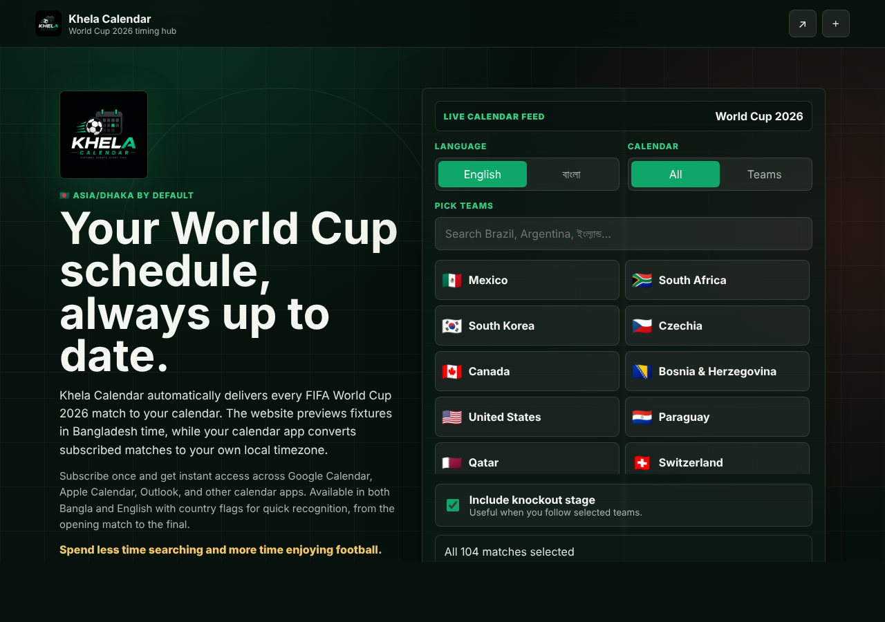

# Khela Calendar

**World Cup 2026 match reminders on your phone, at your own local kickoff time.**

World Cup 2026 is played in North America, so for most fans the kickoff times are in a different time zone and easy to get wrong. With Khela Calendar you open the website on Android or iPhone, pick your favourite teams or matches, and tap Add to calendar. Every match lands in your phone's calendar at the correct kickoff time for wherever you are, so your calendar's reminders and home-screen widget pop up on time. No time-zone maths and no missed matches. Bangla or English.

**How it works:** a static site (`public/`) lets you choose language and teams, and a small serverless function (`api/calendar.js`) builds the matching `.ics` feed on request. No database and no paid backend, so it runs free on Vercel.

## What is included

- Calendar events follow your phone's time zone automatically (the match list on the site shows Bangladesh time)
- Bangla and English team-name toggle
- Country flag emoji on teams and matches
- All-matches calendar feed
- Selected-teams calendar feed
- Optional knockout-stage inclusion
- Apple Calendar, Google Calendar, Android copy URL, and `.ics` download actions
- Free Vercel-ready deployment with no paid backend

## Free deployment

1. Create a free GitHub repository.
2. Upload this project.
3. Import the repository into Vercel.
4. Deploy with the default settings.
5. Replace `https://khela-calendar.vercel.app` in `public/app.js` after you know your final Vercel URL.

## Data notes

The fixture data is stored in `public/data/matches.json`. Before public launch, verify the match list against official schedule announcements.

## Creator link

Creator links are set in `public/index.html`; the calendar event note links to Facebook from `api/calendar.js`.
